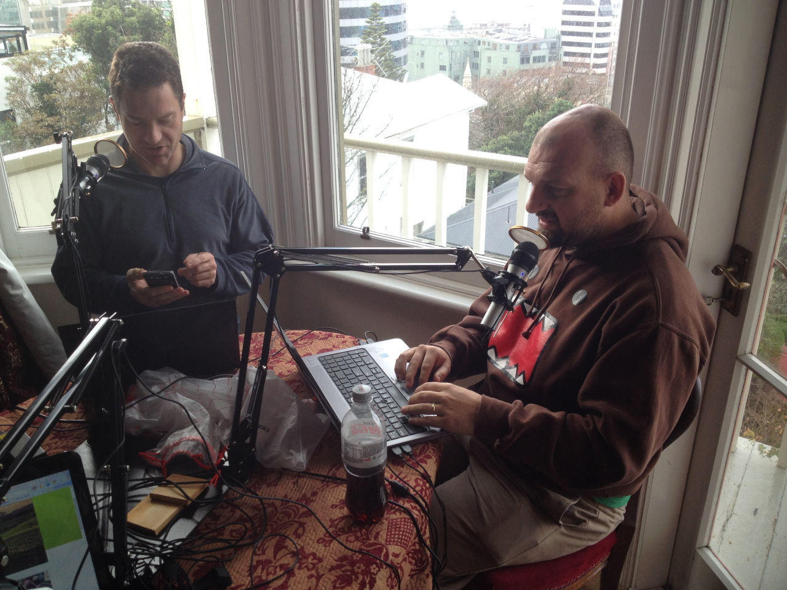
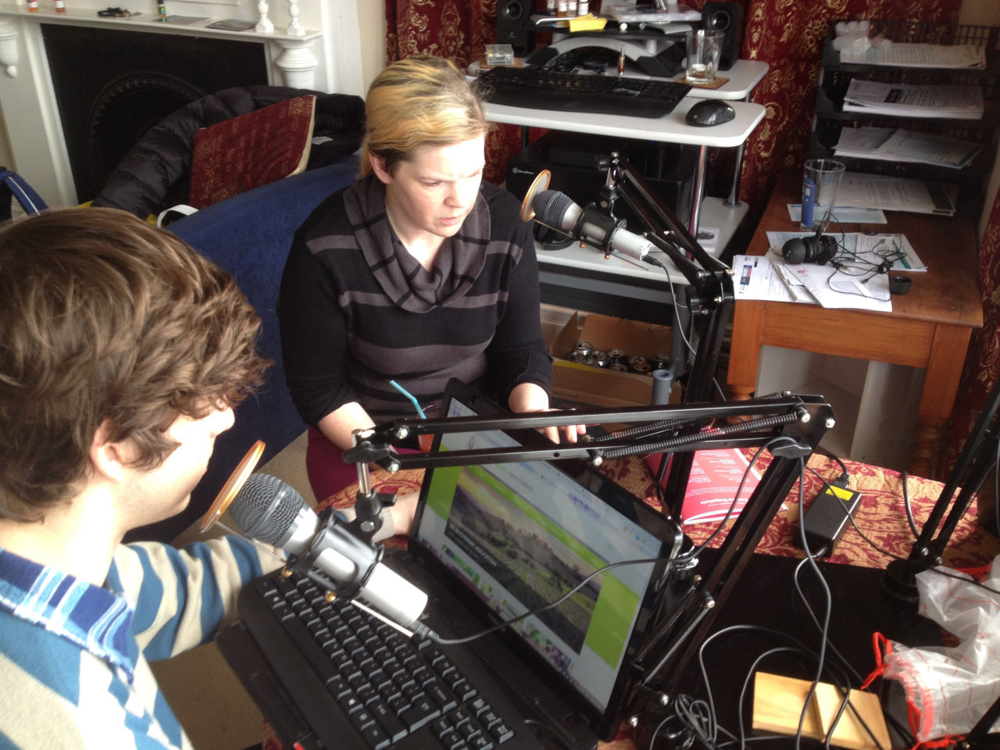

My friend Gordy helped out for my skeptical podcast by building a stand for the microphone arms.

<!-- more -->

The stand is solid steel, and easily heavy enough to offer stability for the microphones.

